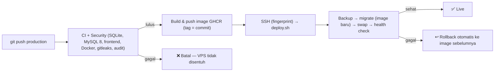

# 🚀 Panduan Deployment & Operasional Produksi (Production Deployment Guide)

Dokumen ini berisi panduan langkah-demi-langkah untuk mendeploy dan mengoperasikan aplikasi web **WALHI Jawa Barat** di server produksi (VPS Ubuntu / Debian / Cloud Server).

---

## 📋 Daftar Isi
1. [Spesifikasi Server Minimum](#-spesifikasi-server-rekomendasi)
2. [Langkah Deployment Produksi (Docker Compose)](#-langkah-deployment-cepat-turnkey-vps-setup)
3. [Konfigurasi Domain & SSL (HTTPS)](#-konfigurasi-domain--ssl-https)
4. [Backup & Restore (Database + File Unggahan)](#-backup--restore-database--file-unggahan)
5. [Monitoring & Manajemen Log](#-monitoring-alokasi-ram--benchmark)
6. [Otomasi Deployment (CI/CD) GitHub Actions (Branch: production)](#-otomasi-deployment-cicd-github-actions-branch-production)
7. [Integritas & Keamanan Database VPS (Anti-Reset & Anti-Data Loss)](#-integritas--keamanan-database-vps-anti-reset--anti-data-loss)
8. [Panduan Load Testing](#-panduan-load-testing-staging--production)

> Server live saat ini: domain `walhijabar.or.id`, direktori `/var/www/walhi_app`, backup di `/var/backups/walhi`. Prosedur harian (deploy ulang, rollback, reset 2FA, SMTP, dll.) ada di [docs/operations.md](docs/operations.md); referensi semua variabel `.env` di [docs/configuration.md](docs/configuration.md).

---

## 💻 Spesifikasi Server Rekomendasi

- **OS:** Ubuntu 22.04 LTS / 24.04 LTS atau Debian 12
- **CPU:** 2 vCPU core
- **RAM:** 8 GB (Telah di-tuning untuk alokasi MySQL 2.5 GB + PHP-FPM 3.0 GB + OS margin 2.5 GB)
- **Disk:** 100 GB NVMe / SSD
- **Bandwidth:** 8 TB / bulan
- **Software Terpasang:** Docker Engine & Docker Compose v2.20+ (`docker-compose-plugin`, dibutuhkan untuk `up --wait`)

---

## 🐳 Langkah Deployment Cepat (Turnkey VPS Setup)

### 1. Masuk ke Server VPS Baru Anda
```bash
ssh root@IP_SERVER_VPS_ANDA
```

### 2. Jalankan Skrip Auto-Setup
Skrip ini akan secara otomatis memperbarui sistem, memasang Swap 2 GB (mencegah crash OOM pada 1 vCPU), mengonfigurasi firewall UFW, menginstal Docker Engine resmi, dan menyiapkan cron backup harian:

```bash
curl -fsSL https://raw.githubusercontent.com/walhijabarhub/WalhiJBRWeb/production/setup-vps.sh -o setup-vps.sh
chmod +x setup-vps.sh
sudo ./setup-vps.sh
```

### 3. Clone Repository ke Direktori Produksi (Branch: production)
```bash
cd /var/www
git clone -b production https://github.com/walhijabarhub/WalhiJBRWeb.git walhi_app
cd /var/www/walhi_app
```

### 4. Siapkan File `.env` Produksi
Salin template produksi dan sesuaikan nilai-nilainya:
```bash
cp .env.production.example .env
nano .env
```

**Konfigurasi Kunci yang Wajib Diisi:**
- `APP_URL=https://walhijabar.or.id`
- `DB_PASSWORD` & `DB_ROOT_PASSWORD` (Gunakan password acak kuat minimal 24 karakter — **DILARANG** menggunakan string default contoh)
- `MIDTRANS_SERVER_KEY` & `MIDTRANS_CLIENT_KEY` (Kunci produksi akun Midtrans resmi)
- `ADMIN_PASSWORD` (Password akun Super Admin)
- `APP_KEY` (wajib; container menolak start tanpa ini). Buat sekali dengan `docker run --rm walhi_larafel-app php artisan key:generate --show` atau `php artisan key:generate --show` di mesin lokal, lalu **jangan pernah diubah** (mengubahnya membuat sesi & secret 2FA tidak bisa dibaca).
- `REDIS_PASSWORD` (`openssl rand -hex 24`)
- `NGINX_SERVER_NAME` (domain tanpa `https://`), `NGINX_CONF=http` untuk start pertama

> [!IMPORTANT]
> **Checklist Keamanan Kredensial Database:**
> 1. Pastikan password database `DB_PASSWORD` dan `DB_ROOT_PASSWORD` bukan string contoh historis (`walhi_secret_pass` / `walhi_root_secret`).
> 2. Generate password baru dengan entropi tinggi: `openssl rand -base64 24`.
> 3. Jika melakukan rotasi password pada database MySQL yang sedang berjalan:
>    ```bash
>    docker exec -it walhi_prod_db mysql -u root -p -e "ALTER USER 'walhi_user'@'%' IDENTIFIED BY 'PASSWORD_BARU_ANDA'; FLUSH PRIVILEGES;"
>    ```
>    Lalu perbarui variabel `DB_PASSWORD` di `.env` dan restart container aplikasi (`docker compose -f docker-compose.prod.yml restart app`).

### 5. Jalankan Stack Produksi
```bash
docker compose -f docker-compose.prod.yml up -d --build
```

Setelah perintah selesai, container berikut berjalan (semua dengan healthcheck — cek dengan `docker compose -f docker-compose.prod.yml ps`):
- `walhi_prod_app` — Laravel 13 / PHP-FPM 8.4
- `walhi_prod_worker` — `queue:work` (email konfirmasi newsletter, notifikasi)
- `walhi_prod_scheduler` — `schedule:work` (rekonsiliasi donasi, flush views, retensi data)
- `walhi_prod_db` — MySQL 8.0
- `walhi_prod_redis` — Redis 7 (session, cache, rate limit, queue; tidak dipublish ke luar)
- `walhi_prod_nginx` — Nginx (server terdepan & terminasi TLS)

### ⬆️ Upgrade Server yang Sudah Berjalan (wajib sebelum deploy versi ini)
Versi ini menambah Redis, worker, scheduler dan template nginx. Lakukan **sebelum** `git pull` / deploy berikutnya, atau deploy akan gagal / HTTPS mati:
1. Tambahkan ke `.env` server:
   ```bash
   REDIS_PASSWORD=$(openssl rand -hex 24)   # isi nilai hasil perintah ini
   NGINX_SERVER_NAME=walhijabar.or.id        # domain sertifikat yang sudah ada
   NGINX_CONF=https                          # karena sertifikat sudah terpasang
   SESSION_DRIVER=redis
   CACHE_STORE=redis
   QUEUE_CONNECTION=redis
   ```
   Pastikan `APP_KEY` sudah terisi (wajib).
2. Salin dokumen privat dari container lama (lihat peringatan di bawah).
3. Deploy, lalu jalankan `sudo ./setup-ssl.sh walhijabar.or.id` sekali untuk memindahkan perpanjangan sertifikat ke metode webroot.
4. Periksa `docker compose -f docker-compose.prod.yml ps` — semua container harus `healthy`/`running`.

### Penyimpanan Persisten
| Volume | Isi |
| :--- | :--- |
| `walhi_prod_app_storage` | `storage/app` — termasuk **dokumen privat** `storage/app/private/documents` |
| `walhi_prod_storage` | `storage/app/public` — unggahan gambar publik (volume lama, tetap dipakai) |
| `walhi_prod_db` | Data MySQL |
| `walhi_prod_redis` | Data Redis (AOF) |
| `walhi_prod_logs` | `storage/logs` (termasuk `audit.log` & `php-fpm-slow.log`) |

> [!WARNING]
> **Upgrade dari versi sebelum volume `walhi_prod_app_storage`:** dulu `storage/app/private` tidak persisten, sehingga dokumen yang diunggah sejak deploy terakhir hanya ada di container yang sedang berjalan. **Sebelum** deploy versi ini, salin dokumen tersebut:
> ```bash
> docker cp walhi_prod_app:/var/www/html/storage/app/private ./backup-private-$(date +%F)
> # setelah deploy:
> docker compose -f docker-compose.prod.yml cp ./backup-private-YYYY-MM-DD/. app:/var/www/html/storage/app/private/
> docker compose -f docker-compose.prod.yml exec app chown -R www-data:www-data storage/app/private
> ```

## 🔒 Konfigurasi Domain & SSL (HTTPS)

### Otomatis Menggunakan Skrip `setup-ssl.sh`:
```bash
cd /var/www/walhi_app
chmod +x setup-ssl.sh
./setup-ssl.sh
```
Skrip ini otomatis:
1. Menginstal certbot.
2. Menerbitkan sertifikat Let's Encrypt untuk `<domain>` & `www.<domain>` dengan **metode webroot** — nginx tetap menyala dan melayani `/.well-known/acme-challenge/` dari `docker/certbot/www`.
3. Memasang hook `/etc/letsencrypt/renewal-hooks/deploy/reload-walhi-nginx.sh` sehingga nginx di-reload setiap kali sertifikat diperpanjang (oleh timer systemd certbot).
4. Mengubah `.env`: `NGINX_CONF=https`, `NGINX_SERVER_NAME`, `APP_URL=https://…`, `SESSION_SECURE_COOKIE=true`, lalu menjalankan ulang stack.

> **Host kanonis: `www.<domain>`.** Pada mode `https`, nginx hanya melayani situs di `https://www.<domain>`. Domain tanpa www, HTTP, dan host lain dialihkan dengan satu `301` ke `https://www.<domain>` (HSTS tetap dikirim di domain tanpa www). Setel `APP_URL=https://www.<domain>`. `/.well-known/acme-challenge/` di port 80 tidak dialihkan agar perpanjangan sertifikat tetap berjalan. Health check `deploy.sh` memeriksa `https://www.<domain>/up`.
5. Menguji perpanjangan dengan `certbot renew --dry-run`.

Konfigurasi nginx kini **versioned di repo** (`docker/nginx/http`, `docker/nginx/https`, `docker/nginx/snippets`) dan dipilih lewat `NGINX_CONF` — tidak ada lagi file yang ditulis ulang di server.

Sertifikat lama yang diterbitkan dengan metode *standalone* otomatis diterbitkan ulang sekali dengan webroot saat skrip dijalankan, sehingga perpanjangan berikutnya tidak lagi membutuhkan port 80 kosong.

### Cloudflare (opsional, disarankan untuk CDN)
1. Aktifkan proxy (awan oranye) untuk domain, mode SSL **Full (strict)** — sertifikat Let's Encrypt di origin tetap diperlukan.
2. Setel `NGINX_REALIP=cloudflare` di `.env` lalu `docker compose -f docker-compose.prod.yml up -d web`. Nginx akan memulihkan IP pengunjung asli dari `CF-Connecting-IP` **hanya** untuk koneksi dari rentang IP Cloudflare (`docker/nginx/realip/cloudflare/cloudflare.conf`).
3. Batasi port 80/443 di firewall VPS hanya untuk rentang IP Cloudflare agar origin tidak bisa diakses langsung. Ingat: port yang dipublish Docker **melewati aturan UFW**; gunakan chain `DOCKER-USER` atau firewall penyedia cloud.
4. Aturan cache Cloudflare untuk `/build/*`, `/assets/*`, `/storage/*` mengurangi beban VPS secara signifikan.

### CAPTCHA (Cloudflare Turnstile)
Form komentar dan newsletter mendukung Turnstile (gratis, tidak perlu domain di Cloudflare).
1. Buka Cloudflare Dashboard → **Turnstile** → *Add site*, isi domain `walhijabar.or.id`, mode *Managed*.
2. Isi `TURNSTILE_SITE_KEY` dan `TURNSTILE_SECRET_KEY` di `.env` server, lalu jalankan `./deploy.sh production` (atau tunggu deploy berikutnya).
3. Tanpa kedua key ini, form tetap berjalan seperti biasa (honeypot + rate limit). Bila API verifikasi Cloudflare tidak bisa dihubungi, kiriman ditolak (*fail-closed*).

### Alamat IP Klien
Nginx adalah server terdepan; IP klien diteruskan ke PHP sebagai `REMOTE_ADDR`, dan header `X-Forwarded-*` dari klien dibuang. `TRUSTED_PROXIES` dibiarkan kosong kecuali ada reverse proxy/load balancer lain di depan nginx. Bila Docker daemon memakai *userland-proxy* (mis. klien IPv6 tanpa `ipv6: true` di daemon), IP yang terlihat adalah gateway Docker — setel `"userland-proxy": false` di `/etc/docker/daemon.json` — **hanya** bila Docker IPv6 juga dikonfigurasi (`"ipv6": true`, `"ip6tables": true`) atau domain tidak punya record AAAA, karena tanpa itu pengunjung IPv6 tidak bisa terhubung.


---

## 💾 Backup & Restore (Database + File Unggahan)

`docker-backup.sh` membuat dua berkas per backup: dump MySQL (`*_mysql_*.sql.gz`) dan arsip `storage/app` (`*_files_*.tar.gz`, berisi dokumen privat dan unggahan publik). Setiap berkas punya pasangan checksum `<berkas>.sha256` (ikut disalin off-site). Skrip **berhenti dengan error** bila dump gagal, terpotong, atau arsip rusak, dan bisa mengirim notifikasi kegagalan.

### Pengaturan (di `.env` server)
| Variabel | Fungsi |
| :--- | :--- |
| `BACKUP_DIR` | Lokasi backup lokal (default `/var/backups/walhi`) |
| `OFFSITE_BACKUP_TARGET` | **Sangat disarankan.** Remote `rclone` (mis. `r2:walhi-backups`) atau `s3://bucket/path` |
| `BACKUP_ALERT_WEBHOOK` | URL (Slack/Discord/dll.) yang menerima pesan JSON saat backup gagal |
| `BACKUP_RETENTION_DAYS` | Retensi backup rutin (default 14 hari; snapshot pra-deploy 30 hari) |
| `OFFSITE_BACKUP_REQUIRED` | Default `false` (hanya peringatan). `true` = backup **gagal + alert** bila `OFFSITE_BACKUP_TARGET` kosong. Aktifkan hanya setelah langkah di bawah selesai. |

### Backup manual & otomatis
```bash
cd /var/www/walhi_app
./docker-backup.sh
```
`setup-vps.sh` memasang cron harian pukul 02.00 yang memanggil skrip yang sama (log: `/var/log/walhi_backup.log`). `deploy.sh` selalu membuat snapshot `walhi_predeploy_*` sebelum deploy dan **membatalkan deploy** bila backup gagal.

### Restore
```bash
./docker-restore.sh /var/backups/walhi/walhi_prod_mysql_YYYYMMDD_HHMMSS.sql.gz \
                    /var/backups/walhi/walhi_prod_files_YYYYMMDD_HHMMSS.tar.gz
```
Skrip meminta konfirmasi (`restore`), mengaktifkan maintenance mode, memulihkan database dan (opsional) file, lalu mematikan maintenance mode. **Uji restore secara berkala** (mis. tiap bulan di server staging) — backup yang belum pernah dipulihkan belum terbukti.

### Uji restore (tanpa menyentuh situs)
```bash
./docker-restore-test.sh walhi_prod_mysql_YYYYMMDD_HHMMSS.sql.gz walhi_prod_files_YYYYMMDD_HHMMSS.tar.gz
```
Memverifikasi checksum, mengimpor dump ke container MySQL **sementara tanpa jaringan** (bukan `walhi_prod_db`, tanpa volume produksi), menampilkan jumlah baris & migrasi terakhir, lalu memeriksa bahwa setiap dokumen yang dirujuk `contents.image_url` ada di arsip. Exit `0` = lengkap, `1` = gagal restore/checksum, `2` = database pulih tetapi ada dokumen hilang. Semua dibersihkan otomatis. Jalankan di staging, atau di VPS saat sepi (container dibatasi 1 GB RAM). Uji dari **salinan off-site**, bukan dari `/var/backups/walhi`.

### Mengaktifkan backup off-site (urutan aman)
Kredensial **tidak pernah** disimpan di repository. Pilihan tujuan: **Cloudflare R2** atau **Amazon S3** (penyimpanan objek terpisah dari VPS; disarankan), atau Google Drive lewat `rclone` (perlu pengelolaan token & retensi).

1. Buat bucket khusus backup dan kunci API dengan akses **hanya** ke bucket itu. Aktifkan lifecycle/retensi di bucket (mis. hapus setelah 90 hari).
2. Di VPS: `apt install rclone` lalu `rclone config` (untuk R2 pilih tipe S3, provider Cloudflare). Konfigurasi tersimpan di `/root/.config/rclone/rclone.conf`; pastikan `chmod 600`.
3. Isi `.env` server: `OFFSITE_BACKUP_TARGET=r2:walhi-backups` (nama remote:bucket). Biarkan `OFFSITE_BACKUP_REQUIRED=false`.
4. Jalankan `./docker-backup.sh`, lalu cek `rclone ls r2:walhi-backups` — harus ada 4 berkas (`.sql.gz`, `.tar.gz`, dan dua `.sha256`).
5. Di staging/mesin lain: unduh salinan off-site dan jalankan `./docker-restore-test.sh` sampai exit `0`.
6. Setelah langkah 4–5 berhasil, setel `OFFSITE_BACKUP_REQUIRED=true` (dan `BACKUP_ALERT_WEBHOOK`) agar backup yang tidak terkirim off-site langsung gagal dan memberi peringatan.

---

## 📊 Monitoring, Alokasi RAM & Benchmark

### Anggaran Memori pada VPS 8 GB RAM:
Container produksi dibatasi secara optimal (*resource limits*) untuk memaksimalkan throughput sekaligus mencegah crash akibat *Out of Memory (OOM)*:
- **`walhi_prod_app` (PHP-FPM 18 workers)**: Limit **2.048 MB** (Reservasi: 512 MB)
- **`walhi_prod_worker` (queue worker)**: Limit **384 MB**
- **`walhi_prod_scheduler` (schedule:work)**: Limit **256 MB**
- **`walhi_prod_db` (MySQL 8.0, buffer pool 1.5 GB)**: Limit **2.560 MB** (Reservasi: 1.024 MB)
- **`walhi_prod_redis`**: Limit **256 MB** (`maxmemory` 200 MB)
- **`walhi_prod_nginx`**: Limit **256 MB**
- **Headroom OS, Page Cache & Linux Buffers**: **~2.2 GB** + Swap

### Healthcheck & Pemantauan
- `docker compose -f docker-compose.prod.yml ps` menampilkan status `healthy` tiap container (PHP-FPM via `/ping`, nginx via `/nginx-health`, MySQL, Redis).
- Endpoint aplikasi `/up` cocok untuk uptime monitor eksternal (UptimeRobot, Better Stack, dll.). Pasang alert untuk `/up`, tanggal kedaluwarsa sertifikat, dan ruang disk.
- Request PHP yang lebih lambat dari 5 detik tercatat di `storage/logs/php-fpm-slow.log`.

### Memeriksa Penggunaan CPU & RAM Realtime:
```bash
docker stats
```
> **Target Normal:** Total konsumsi RAM server berada di kisaran 50% – 70%. Jika beban puncak (*peak*) mencapai 75% – 85%, server masih memiliki toleransi aman tanpa risiko *kernel panic*.

### Melihat Log Realtime:
```bash
# Log seluruh stack produksi
docker compose -f docker-compose.prod.yml logs -f

# Log Laravel application saja
docker compose -f docker-compose.prod.yml logs -f app
```

---

## 🚀 Otomasi Deployment (CI/CD) GitHub Actions (Branch: production)

Saat ada push ke `production`, workflow `deploy.yml` menjalankan:
1. **Gatekeeper:** memanggil `ci.yml` (test SQLite **dan MySQL 8.0**, build frontend, build Docker, validasi compose) dan `security.yml` (gitleaks, `composer audit`, `npm audit`, test) sebagai *reusable workflow*. Image baru dibangun hanya jika **semua** job di kedua workflow lulus. Gagal = tidak ada yang dideploy.
2. **Build image sekali di CI** dan push ke GHCR sebagai `ghcr.io/walhijabarhub/walhijbrweb:<12-char-commit-sha>`. VPS tidak lagi membangun image.
3. **Deploy via SSH** (host key diverifikasi lewat `fingerprint`, environment `production`) yang memanggil `./deploy.sh production <sha>` dari commit yang sama.

Workflow `ci.yml` menjalankan test di SQLite **dan MySQL 8.0**, build aset, build image, dan validasi `docker-compose.prod.yml`. Workflow `security.yml` menjalankan gitleaks (seluruh riwayat), `composer audit`, dan `npm audit`. Keduanya berjalan di setiap PR; untuk push ke `production` keduanya dijalankan oleh `deploy.yml` sebagai gate (tidak dobel). Semua action dikunci ke commit SHA; Dependabot memperbarui dependensi tiap minggu.

### Perlindungan branch `production` (oleh owner organisasi)

PR tidak bisa mengaktifkan branch protection; pengaturan ini butuh akses **admin**. Settings → Rules → Rulesets → *New branch ruleset*, target `production`:

- *Restrict deletions* dan *Block force pushes*
- *Require a pull request before merging*
- *Require status checks to pass*, dengan nama check persis seperti yang diterbitkan GitHub Actions pada PR:
  `PHP Tests (SQLite)`, `PHP Tests (MySQL 8.0)`, `Frontend Assets Build`, `Docker Build Validation`, `Dependency Security Scan & Security Tests`, `walhijabar_reviewbot`



### Alur `deploy.sh`
1. Pre-flight: `.env`, variabel wajib (`APP_KEY`, `DB_PASSWORD`, `DB_ROOT_PASSWORD`, `REDIS_PASSWORD`), ruang disk ≥ 2 GB, dan `NGINX_CONF=https` otomatis bila sertifikat ada.
2. Backup database + file (gagal = deploy batal; darurat: `SKIP_BACKUP=true`).
3. Checkout commit, ambil image (pull dari GHCR bila `APP_IMAGE` berisi registry, build lokal bila tidak).
4. Maintenance mode lewat Redis (bertahan meski container dibuat ulang). Secret bypass acak per deploy.
5. **Migrasi dengan image baru sebelum swap** (`docker compose run --rm app php artisan migrate --force`). Bila gagal, versi lama tetap melayani.
6. Swap container + restart nginx (template dirender ulang).
7. Health check (`/up` lewat nginx). Bila gagal → **rollback otomatis** ke image, tag, dan commit terakhir yang sehat (`.deploy/last_good`). Catatan: migrasi yang sudah jalan tidak dibatalkan otomatis; gunakan `docker-restore.sh` dengan snapshot pra-deploy bila perlu.

### 🔑 Setup sekali
1. **SSH key deploy** di VPS:
   ```bash
   ssh-keygen -t ed25519 -C "github-actions-walhi-deploy" -f ~/.ssh/id_ed25519_deploy -N ""
   cat ~/.ssh/id_ed25519_deploy.pub >> ~/.ssh/authorized_keys
   ssh-keyscan -t ecdsa localhost | ssh-keygen -lf -     # salin fingerprint SHA256:... (kunci ECDSA)
   ```
2. **Secrets** (Settings → Secrets and variables → Actions):

   | Secret | Nilai |
   | :--- | :--- |
   | `VPS_HOST` | IP/domain VPS |
   | `VPS_USERNAME` | User SSH dengan akses docker |
   | `VPS_SSH_KEY` | Isi private key `~/.ssh/id_ed25519_deploy` |
   | `VPS_SSH_PORT` | Port SSH (default 22) |
   | `VPS_SSH_FINGERPRINT` | Fingerprint host key **ECDSA**, format `SHA256:...` (tipe kunci yang dipakai klien SSH di Actions) |
3. **Environment `production`** (Settings → Environments): opsional, tambahkan *required reviewers* agar deploy perlu persetujuan (butuh akses admin repo). Saat ini deploy berjalan otomatis tanpa persetujuan.
4. **Akses image GHCR di VPS:** otomatis. Job deploy login ke `ghcr.io` memakai `GITHUB_TOKEN` yang hanya berlaku selama job berjalan, lalu logout lagi, sehingga package boleh tetap private. Untuk deploy manual dengan image dari GHCR, login sendiri sementara dengan token `read:packages`.
5. Pastikan **GitHub Actions aktif** untuk akun/repo (masalah billing pada akun membuat semua job gagal start).

### Deploy manual dari VPS
```bash
cd /var/www/walhi_app
APP_IMAGE=ghcr.io/walhijabarhub/walhijbrweb ./deploy.sh production   # pakai image dari CI
./deploy.sh production                                            # atau build di server
```

---

## 🗄️ Integritas & Keamanan Database VPS (Anti-Reset & Anti-Data Loss)

### Mengapa Database di VPS Sempat Berubah/Ter-reset di Masa Lalu?
Berdasarkan investigasi menyeluruh, data database di VPS sempat ter-reset karena:
1. **Flag `SEED_ON_START=true`**: Menjalankan `docker compose up` tanpa `-f docker-compose.prod.yml` memicu pembacaan `docker-compose.yml` bawaan lokal yang memuat `SEED_ON_START=true`, sehingga seeder menimpa artikel nyata dengan dummy data seeder.
2. **Perintah `migrate:fresh`**: Menghapus seluruh tabel dan membuat ulang dari kosong.
3. **Volume Loss (`docker compose down -v`)**: Flag `-v` menghapus persistent volume database MySQL/SQLite.

### 🛡️ Aturan Perlindungan Database yang Kini Terpasang:
1. **Hanya Migrasi Non-Destruktif:** `deploy.sh` **hanya** menjalankan `php artisan migrate --force`. Dilarang keras `migrate:fresh`, `migrate:refresh`, atau `db:seed` di produksi.
2. **`SEED_ON_START=false`** di `docker-compose.prod.yml` dan `.env.production.example`. Selalu jalankan perintah compose produksi dengan `-f docker-compose.prod.yml`.
3. **Backup pra-deploy otomatis:** setiap deploy membuat snapshot `walhi_predeploy_*` (DB + file) di `BACKUP_DIR` (default `/var/backups/walhi`) dan membatalkan deploy bila backup gagal.
4. **Isolasi Volume Docker:** volume MySQL `walhi_prod_db` terpisah dari image. Jangan pernah menjalankan `docker compose down -v` di server.
5. **Git Ignore Database:** file SQLite (`*.sqlite`, `*.sqlite-shm`, `*.sqlite-wal`) diabaikan git.
6. **Maintenance mode lewat Redis** selama migrasi, sehingga pengunjung tidak menulis data setengah jalan.

### 🔄 Prosedur Rollback Darurat Database (Disaster Recovery):
Jika migrasi atau data rusak dan database perlu dikembalikan ke titik sebelum deploy terakhir:

```bash
cd /var/www/walhi_app

# 1. Cari snapshot pra-deploy terbaru
ls -lt /var/backups/walhi/walhi_predeploy_*

# 2. Pulihkan (meminta konfirmasi, mengaktifkan maintenance mode otomatis)
./docker-restore.sh /var/backups/walhi/walhi_predeploy_mysql_YYYYMMDD_HHMMSS.sql.gz \
                    /var/backups/walhi/walhi_predeploy_files_YYYYMMDD_HHMMSS.tar.gz

# 3. Bila kode juga perlu kembali ke versi sebelumnya, deploy ulang commit lama
#    (lihat "Rollback kode" di docs/operations.md)
```

---

## 🧪 Panduan Load Testing Staging / Production

Sebelum promosi traffic masif, lakukan pengujian konkurensi bertahap dari workstation pengembang atau server staging:

```bash
# Menggunakan ApacheBench (ab) atau k6 / wrk
# Uji coba 100 request dengan 10 concurrent users:
ab -n 100 -c 10 https://walhijabar.or.id/

# Uji coba 500 request dengan 25 concurrent users:
ab -n 500 -c 25 https://walhijabar.or.id/

# Uji coba 1000 request dengan 50 concurrent users:
ab -n 1000 -c 50 https://walhijabar.or.id/
```
Amati keluaran `docker stats`. Jika penggunaan RAM per PHP-FPM worker stabil dan antrean request rendah, nilai `pm.max_children` di `docker/php/zz-docker.conf` (saat ini 18) dapat disesuaikan bertahap berdasarkan data aktual, dengan tetap memperhatikan limit memori container `app`.
